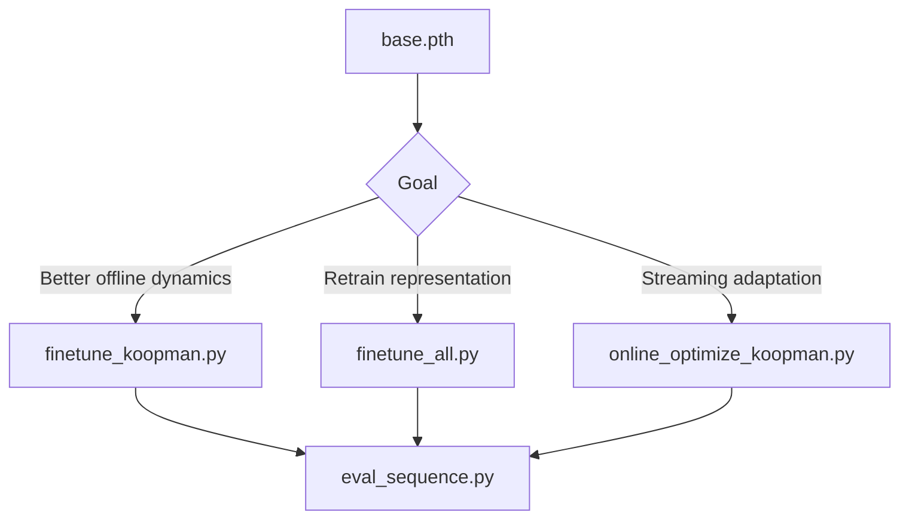

# OnlineDeepKoopman

Deep Koopman vehicle dynamics modeling with **offline fine-tuning** and **event-triggered online adaptation** of Koopman matrices. Built on TruckSim 7-DOF three-axle simulation data and aligned with the Deep Koopman formulation in *Deep Neural Networks With Koopman Operators for Modeling and Control of Autonomous Vehicles* (IEEE T-IV, 2023).

## Overview

The pipeline lifts a 6D physical state into a 16D latent space, then applies affine Koopman dynamics:

```
z_{t+1} = z_t @ A + u_t @ B
```

| Symbol | Dimension | Description |
|--------|-----------|-------------|
| `s` | 6 | `x, y, θ, vx, vy, ωz` |
| `u` | 12 | 6 wheel torques + 6 steer angles (normalized) |
| `z` | 16 | `concat(s, encoder(s))` — first 6 dims are physical states |

**Offline:** fine-tune from `base.pth` (encoder frozen or joint).  
**Online:** freeze encoder; stream data in time order; when 100-step ADE exceeds a threshold, update only `A` and `B` on a sliding window with regularization toward the initial matrices.

## Repository layout

```
OnlineDeepKoopman/
├── base.pth                      # Pretrained checkpoint (required)
├── finetune_koopman.py           # Offline: train Koopman only (encoder frozen)
├── finetune_all.py               # Offline: joint encoder + Koopman
├── online_optimize_koopman.py    # Online: event-triggered A,B updates
├── eval_sequence.py              # Evaluate any checkpoint on long horizons
├── show_trajectory.py            # Plot GT xy trajectory from one mat file
├── ckpt/                         # Saved fine-tuned weights
├── log/                          # Training / online metric logs
├── data/                         # TruckSim .mat scenarios (not in git)
└── src/
    ├── loader.py                 # Dataset
    ├── parse_data.py             # MAT I/O
    ├── encoder.py                # Transformer encoder
    ├── Koopman.py                # Koopman variants (default: Koopmanv1)
    └── ...
```

## Requirements

- Python 3.8+
- CUDA GPU recommended (`cuda:0` is the default in scripts)

```bash
pip install torch numpy scipy pandas matplotlib tqdm
```

## Data

Place TruckSim MAT files under:

```
data/data_scenarios_for_differ_params_v8/
  VehicleParams_Izu{A|B|C}_IzulA_Rr{A|B|C}_CdA_BcdA-m_sprung{A|B|C}-Lfm{A|B|C}/
    *.mat
```

**Condition keys** (3×3 parameter grid): `AA`, `AB`, `AC`, `BA`, `BB`, `BC`, `CA`, `CB`, `CC`.

**Split (all training scripts):**

- First sorted `.mat` in a condition folder → **train**
- Remaining files → **validation**

**Preprocessing in code:**

- `(x, y)` shifted to the sequence origin (local frame)
- Controls min–max normalized with fixed bounds (`±1500` N·m torque, `±π/2` rad steer)

## Checkpoints

| File | Contents |
|------|----------|
| `base.pth` | `encoder`, `koopman` — starting point for all scripts |
| `ckpt/finetune-koopman-{COND}.pth` | Koopman-only fine-tune |
| `ckpt/finetune-all-{COND}.pth` | Joint fine-tune |

Checkpoint dict keys: `encoder`, `koopman`, optional `eval_results`, `epoch`, `best_loss`.

> **Note:** This repo does not include a script to train `base.pth` from scratch. Obtain it externally or from the upstream project.

---

## Quick start

Run all commands from the repository root:

```bash
cd OnlineDeepKoopman
```

Ensure `base.pth` and `data/` are present.

---

## Training

### 1. Fine-tune Koopman only (encoder frozen)

Best when the encoder is already strong and you want a lightweight dynamics update.

1. Open `finetune_koopman.py` and set:

   ```python
   CONDITION = 'AB'   # AA … CC
   DEVICE = torch.device('cuda:0')  # or 'cpu'
   ```

2. Run:

   ```bash
   python finetune_koopman.py
   ```

**Defaults:** 100 epochs, horizon 100 steps, batch 512, Adam lr `1e-5` on Koopman only.

**Outputs:**

- `log/finetune-koopman-{CONDITION}.log`
- `ckpt/finetune-koopman-{CONDITION}.pth` (via EarlyStopping on **train** loss; patience 1000)

**Loss:** multi-step + single-step state/feature L2, physics-informed kinematic term, light L2 on Koopman weights.

> Eval metrics inside this script are computed on the **training** loader. Use `eval_sequence.py` for validation-set numbers.

---

### 2. Joint fine-tune (encoder + Koopman)

Trains both modules from `base.pth`; validation metrics are logged each epoch.

1. Set `CONDITION` and `DEVICE` in `finetune_all.py`.
2. Run:

   ```bash
   python finetune_all.py
   ```

**Outputs:**

- `log/finetune-all-{CONDITION}.log`
- `ckpt/finetune-all-{CONDITION}.pth`

EarlyStopping restores best weights on train loss (`restore_best_weights=True`).

---

### 3. Online Koopman adaptation

Streams the **first** training MAT in time order (`horizon=1`, `batch_size=1`). Encoder is frozen; only `A`, `B` update when rolling 100-step xy ADE exceeds a threshold.

```bash
python online_optimize_koopman.py \
  --condition AB \
  --device cuda:0 \
  --window-size 100 \
  --trigger-threshold 0.2 \
  --update-epochs 50 \
  --lr 1e-4 \
  --reg-lambda 1e-3 \
  --metric-log-path log/online_koopman_metrics.csv \
  --save-path ckpt/online-koopman-AB.pth
```

| Argument | Default | Meaning |
|----------|---------|---------|
| `--condition` | `AB` | Parameter scenario key |
| `--window-size` | `100` | Sliding window length |
| `--trigger-threshold` | `0.2` | Update if 100-step xy ADE > threshold |
| `--update-epochs` | `50` | Gradient steps per trigger |
| `--reg-lambda` | `1e-3` | Penalty toward initial `A`, `B` |
| `--max-steps` | `-1` | Cap stream steps (`-1` = full sequence) |
| `--save-path` | `""` | Optional output checkpoint |

Loads weights from `base.pth` via `finetune_koopman.build_model()`. Prints validation metrics **before** and **after** online streaming.

**CSV columns:** `step, ade_xy_100, fde_xy_100, mse_state_100, triggered, update_state_loss, update_reg_loss`

For a quick smoke test:

```bash
python online_optimize_koopman.py --condition AB --max-steps 5000
```

---

## Evaluation & testing

### Long-horizon metrics (`eval_sequence.py`)

Edit the `__main__` block:

```python
eval_condition = 'CC'      # condition key
eval_length = 100          # rollout horizon (steps)
# ckpt_path in build_model()
```

```bash
python eval_sequence.py
```

Change `build_model(ckpt_path='...')` to compare checkpoints, e.g.:

- `base.pth`
- `ckpt/finetune-koopman-AB.pth`
- `ckpt/finetune-all-AB.pth`
- `ckpt/online-koopman-AB.pth`

**Reported metrics:**

| Metric | Description |
|--------|-------------|
| ADE | Mean L2 error on `(x, y)` over the horizon |
| FDE | Final-step L2 error on `(x, y)` |
| Yaw avg / final | Mean / final absolute heading error (deg) |
| `vx`, `vy`, `wz` | Mean absolute errors |

`skip` is `100` for horizons `< 300`, else `25` (controls dataset stride).

---

### Trajectory visualization

```bash
python show_trajectory.py
```

Set `eval_condition` in the script. Writes `trajectory.png` (GT xy path from the first validation file).

---

### Reading training logs

Offline logs alternate epoch blocks, e.g.:

```
DKM model ADE: ..., FDE: ...
DKM model yaw avg error: ..., yaw final error: ...
vx_eval_error: ..., vy_eval_error: ..., wz_eval_error: ...
```

Example (AB, 100-step, after Koopman-only fine-tune on **train**): ADE ≈ 0.008, FDE ≈ 0.018. Joint fine-tune on **validation** is typically higher (≈ 0.05 ADE) — check your target split when comparing runs.

---

## Configuration reference

Shared hyperparameters (top of `finetune_koopman.py` / `finetune_all.py`):

| Parameter | Value |
|-----------|-------|
| `ITERS` | 100 (prediction horizon in training) |
| `BATCH_SIZE` | 512 |
| `MAX_EPOCH` | 100 |
| Encoder | `CustomEncoderUnscaledv2WithoutNorm(state_dim=6, hidden_dim=16, layer_depth=6)` |
| Koopman | `Koopmanv1(state_dim=6, hidden_dim=16, control_dim=12)` |

To run another condition, change `CONDITION` and re-run. Data paths are resolved automatically from the condition dict in each script.

---

## Model variants (advanced)

`src/Koopman.py` defines additional operators (`Koopmanv1MoE*`, `StrictStableKoopman`, `ResdiualKoopman`, `EigenKoopman`, …). They are **not** wired into the default training entry points; swap the class in `build_model()` and adjust dimensions if experimenting.

`src/rule_model.py` provides a 7-DOF bicycle baseline and is not used by the main pipeline.

---

## Typical workflow



1. Verify `base.pth` on target condition with `eval_sequence.py`.
2. Run `finetune_koopman.py` (fast) or `finetune_all.py` (full model).
3. Re-evaluate on validation MAT files.
4. Optional: `online_optimize_koopman.py` for deployment-style `A,B` updates.
5. Compare checkpoints and inspect `log/*.log` / `log/online_koopman_metrics.csv`.

---

## Troubleshooting

| Issue | Action |
|-------|--------|
| `FileNotFoundError` for `base.pth` | Place pretrained checkpoint in repo root |
| Empty / missing `data/` | Download TruckSim scenario MATs into the expected folder tree |
| CUDA OOM | Lower `BATCH_SIZE` or use `--device cpu` (online) |
| `Condition` assert fails | Use only `AA`–`CC` keys |
| Online run is slow | Use `--max-steps` for debugging; full stream equals one long MAT sequence |

---

## Citation

If you use this codebase, cite the T-IV 2023 Deep Koopman paper and acknowledge the TruckSim data source used for your scenarios.

## License

No license file is bundled; confirm terms with the repository owner before redistribution.
